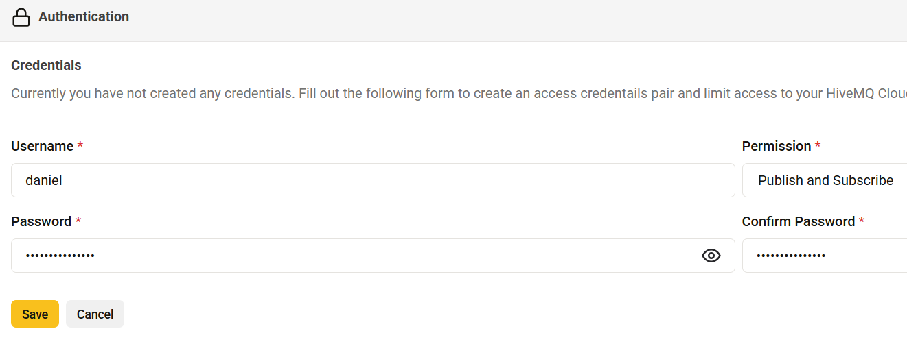
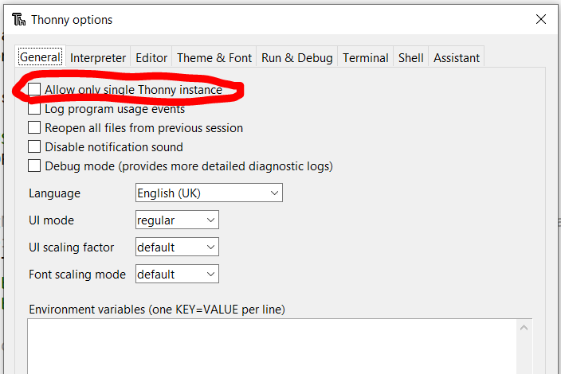

# CS12001 Lab 6 - Pi-to-Pi Communication
Good afternoon everyone! This lab is building upon last week's lab, but this time we'll be using a special free-to-use MQTT broker (Hive MQTT) to allow two Raspberry Pi devices to communicate.

The aim of the lab is:
- To create some code that connects to Hive MQTT and publishes some sensor data
- To create a separate piece of code that subscribes to this sensor data
- To see if you can get two devices working together so that one can be remotely controlled by the other.


# Getting started with Hive MQTT
In this lab, we'll be using Hive MQTT, which is a free MQTT Broker (unless you're dealing with loads of devices) that is a bit easier to work with than Amazon AWS, although arguably less secure.

## Step 1 – Pick your topic name

Last year there was account creation and other complications, but this year there is nothing to sign up for. HiveMQ runs a public broker at broker.hivemq.com that anyone can use for free, with no account, username or password. [Click here](https://broker.hivemq.com) to access it.

The catch: it's public. Everyone in this room, and anyone else in the world, is using the same broker. If we all publish to /button, we'll all be turning each other's LEDs on and off. So every topic you use should start with a prefix that's unique to you, like:

```py
cs12001/<your-name>/button
```

For example, cs12001/drough/button. Use lowercase letters, no spaces, and write your topic down because you'll need it in every step below.

Never send anything private over the public broker. Anyone who guesses your topic can read your messages, and anyone can publish to it too. That's fine for button presses; it's not fine for passwords, names or anything personal.



## Step 2 - Install Thonny
Actually you should have done this last week. If you **didn't**, go back to last week's lab, read the instructions, install Thonny, add the umqtt.simple package, and come back. I'll still be here.

## Step 3 - Publishing to your MQTT broker
It's code time! In this case, we'll be making two separate applications - one that *publishes*, and one that *subscribes*. Later, once you're done, you can find someone else with a Pico to see if you can publish and subscribe to one another (or just grab an extra Pico if there's one laying around and you're not into talking to other people). I found a box in my house that I forgot about with like 8 more which I've put in the room with the others.

Anyway, here is some code to publish to a topic, that we'll be subscribing to soon. Copypaste this into a file and call it 'publish.py' or something like that.

```py
# module imports
import machine
import network
import ssl
import time
import ubinascii
import ujson

from umqtt.simple import MQTTClient

#MODIFY THIS STUFF HERE
SSID = "YOUR_NETWORK_ID"
WIFI_PASSWORD = "YOUR_WIFI_PASSWORD"
PUB_TOPIC = b'cs12001/YOUR-NAME/button'   # your unique topic from Step 1

# HiveMQ public broker - no username or password needed
BROKER = b'broker.hivemq.com'

# Every client on the broker needs a unique ID, so we build one
# from the Pico's own serial number
CLIENT_ID = b'pico-' + ubinascii.hexlify(machine.unique_id())

# Register Pin 8 to check for a connection completed by the button
# Remember, the PULL_DOWN is important!
button = machine.Pin(8, machine.Pin.IN, machine.Pin.PULL_DOWN)

# Wifi Connection Setup as usual
def wifi_connect():
    print('Connecting to wifi...')
    wlan = network.WLAN(network.STA_IF)
    wlan.active(True)
    wlan.connect(SSID, WIFI_PASSWORD)
    while wlan.isconnected() == False:
        print('Waiting for connection...')
        time.sleep(0.5)
    print('Connection details: %s' % str(wlan.ifconfig()))

#This returns 'on' if our button is pressed, and 'off' if it isn't.
def get_button_state():
    if button.value():
        return "on"
    else:
        return "off"

# Connect to wifi
wifi_connect()

# Set HiveMQTT connection details
mqtt = MQTTClient(
    client_id=CLIENT_ID,
    server=BROKER,
    port=8883,
    keepalive=5000,
    ssl=True,
    ssl_params={'server_hostname':BROKER})

# Establish connection to HiveMQTT
mqtt.connect()

while True:
    # Publish the button's state
    message = b'{"state":"%s"}' % get_button_state()
    print('Publishing topic %s message %s' % (PUB_TOPIC, message))
    mqtt.publish(topic=PUB_TOPIC, msg=message)
    time.sleep(1)
```

You only need to change three things: your WiFi ```SSID```, your ```WIFI_PASSWORD```, and ```PUB_TOPIC``` (put your own name in it).

### Check it with the HiveMQ browser client
Before running your code, open the HiveMQ MQTT browser client in a web browser.

1. Leave the host as broker.hivemq.com and the port as 8884 (tick SSL), then click Connect.
2. Click Add New Topic Subscription, enter your exact topic (e.g. cs12001/jsmith/button) and click Subscribe.
3. Nothing should happen yet (unless you already ran your code, in which case STOP JUMPING AHEAD).
4. Now run publish.py in Thonny. You should see {"state":"off"} messages arrive once a second, switching to {"state":"on"} while you hold the button.
The next step is to get an actual client — another Pico W — to receive the messages and do something with them.
Step 4 – Subscribe from a seco

## Step 4 - Subscribing to your MQTT broker
This next piece of code looks very similar, but rather than publishing messages to the '/button' topic, it's **subscribing** to them. The idea here is that when the subscriber receives a message that the publisher's button is pressed, it'll turn on the subscriber's LED. It's Pi-to-Pi through WiFi! Here is the subscriber code, with the same stuff to fill in.

```py
# module imports
import machine
import network
import ssl
import time
import ubinascii
import ujson
from umqtt.simple import MQTTClient

#MODIFY THIS STUFF HERE
SSID = "YOUR_NETWORK_ID"
WIFI_PASSWORD = "YOUR_WIFI_PASSWORD"

CLIENT_ID = b'ANYTHING_YOU_LIKE'
HIVE_URL = b'c9523fb0f87b407f9aeefe715b86eef5.s1.eu.hivemq.cloud'
USERNAME = b'your_credential_username'
PASSWORD = b'your_credential_password'

#The topic we're subscribing to (in this case, a button press)
SUB_TOPIC = b'/button'

#For this you'll need to connect an LED to Pin 5 and a GND pin
light = machine.Pin(5, machine.Pin.OUT)
light.off()
 
# WiFi setup, same as before
def wifi_connect():
    print('Connecting to wifi...')
    wlan = network.WLAN(network.STA_IF)
    wlan.active(True)
    wlan.connect(SSID, WIFI_PASSWORD)
    while wlan.isconnected() == False:
        print('Waiting for connection...')
        time.sleep(0.5)
    print('Connection details: %s' % str(wlan.ifconfig()))

# Callback function for subscriptions - a bit different from last time
def mqtt_subscribe_callback(topic, msg):
    print("Received topic: %s message: %s" % (topic, msg))
   
    if topic == SUB_TOPIC:
        #Turn the message we received into JSON
        mesg = ujson.loads(msg)
        #Find the 'state' key in the message
        if 'state' in mesg.keys():
            #and check whether it's 'on' or ON' or 'On' or whatever
            if mesg['state'] == 'on' or mesg['state'] == 'ON' or mesg['state'] == 'On':
                #if so, turn our LED on
                light.on()
                print('Light is ON')
            else:
                #otherwise, turn it off
                light.off()
                print('Light is OFF')

# Connect to wiFi
wifi_connect()

# Set HiveMQTT connection details
mqtt = MQTTClient(
    client_id=CLIENT_ID,
    server=HIVE_URL,
    port=8883,
    user=USERNAME,
    password=PASSWORD,
    keepalive=5000,
    ssl=True,
    ssl_params={'server_hostname':HIVE_URL})

# Establish connection to HiveMQTT
mqtt.connect()

# Set callback for subscriptions
mqtt.set_callback(mqtt_subscribe_callback)

# Subscribe to topic
mqtt.subscribe(SUB_TOPIC)

# Main loop - with 5 sec delay
while True:
    mqtt.check_msg()
    time.sleep(1)
```
This code, like last week's code, has the 'callback' function that is used to subscribe for updates (our publisher code didn't have this). In this function, it receives a message like you saw in the Hive MQTT Web Client ({"state": "on"} or {"state":"off"}). We can extract information from this message to actually do something!

The code here relies on you having an LED connected with the long leg (anode) to Pin 5, and the short leg (cathode) to a Ground pin. If you connect your LED to a different pin, then you can modify the code to suit.

## Step 5 - Checking it works
Now, if you have two Pico Ws, you can test this by yourselves (but don't all go hogging two Pis or there won't be enough to go around). Thonny will get upset if you try to run more than one Pico at the same time. You can solve this by going to Tools -> Options and then unchecking the box that says "Allow only single Thonny instance". This will let you run the publisher Pico and the subscriber Pico at the same time.



But! I'd encourage you to try to connect to each other's Picos. One Pico runs the publisher code, another runs the subscriber code, and you'll need to make sure that your HiveMQTT URL is the same, and that one group adds credentials for the other group to publish and/or subscribe.

All being well, when the publisher Pico has the button pressed, the LED connected to the subscriber Pico will light up. If so, congratulations! You have the basis for an MQTT IoT network.

## Anything else?
If you've got this far, why not try substituting the 'sensor' on the publisher and the 'actuator' on the subscriber with other things? For example, you could swap out the button for a light-dependent resistor (or one of our new [light sensors](https://thepihut.com/products/photo-transistor-light-sensor)) to make an automatic light, so that when it's dark the LED will come on. 

Alternatively, you could try using one of the [motion detection sensors](https://thepihut.com/products/breadboard-friendly-mini-pir-motion-sensor-with-3-pin-header) connected to the publisher, with a buzzer connected to the subscriber, as a remote burglar alarm.

## Anything anything else?
Yes! Get thinking about your first assignment. What ideas do you have? Come up with as many as possible. What sensors will you need for that idea? What actuators? What kind of network connectivity will you need? 